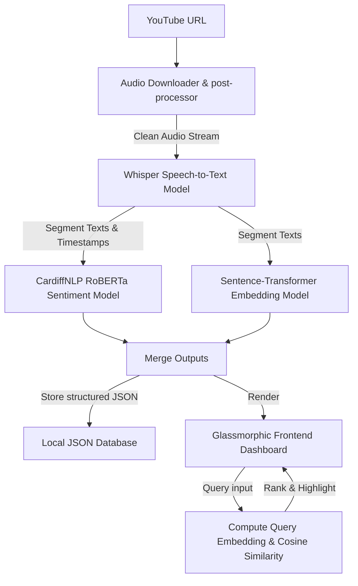

# SpeechInsight: Speech-to-Text & Semantic NLP Pipeline

SpeechInsight is a high-fidelity, deep learning-based Speech-to-Text NLP pipeline and analytical dashboard. It automates political speech and lecture analysis from YouTube URLs using automated audio extraction workflows, OpenAI Whisper transcription with alignment timestamps, Hugging Face Transformers for sentiment tone polarity profiling, and Sentence Transformers to map semantic vector space queries.


## Key Features

1. **Automated YouTube Audio Extraction**: Input any public YouTube video link and extract clean audio streams automatically using `yt-dlp` and `ffmpeg` post-processing.
2. **Robust Speech-to-Text**: Whisper model transcription producing structured text synced with precise segment-level start/end timestamps.
3. **Multi-Class Sentiment Tone Profiling**: Batch inference mapping segment statements to POSITIVE, NEUTRAL, and NEGATIVE sentiment tags (using a CardiffNLP Twitter RoBERTa sentiment classifier).
4. **Semantic Similarity Workflow**: Pre-computes sentence vector embeddings for all segments using Sentence Transformers (`all-MiniLM-L6-v2`) and matches queries using Cosine Similarity calculations to rank and isolate matching ideas.
5. **Dynamic Dashboard Visualizations**:
   - Sleek dark theme with frosted glass containers (glassmorphism) and smooth interactive hover effects.
   - Interactive line chart mapping tone variation over time.
   - Live progress indicator with real-time pipeline status logging.
   - Transcript segment inspector with color-coded sentiment labels and click-to-highlight animations.
   - Full data export in structured JSON formats.
6. **Archive Management**: A local database history log keeping track of past analyses for quick reloading and comparative research.

---

## Architecture & Workflow



---

## Directory Structure

```
speech-nlp-pipeline/
├── backend/
│   ├── __init__.py
│   ├── app.py            # FastAPI main server & routers
│   ├── downloader.py     # YouTube audio downloader (yt-dlp)
│   ├── transcriber.py    # Whisper speech-to-text transcribers
│   ├── analyzer.py       # Sentiment batch analysis & sentence embeddings
│   └── database.py       # JSON database manager for history archiving
├── frontend/
│   ├── index.html        # Dashboard HTML5 layout
│   ├── style.css         # Glassmorphic vanilla CSS design system
│   └── app.js            # Frontend logic, charts & HTTP routing
├── data/
│   └── audio/            # Temp directory for downloaded audio (auto-cleaned)
├── .gitignore            # Git exclusion rules
├── requirements.txt      # Python dependencies
├── run.sh                # Local server runner script
└── setup_github.sh       # Git setup and GitHub CLI push automation script
```

---

## Installation & Setup

### Prerequisites

Ensure you have the following installed on your machine:
- **Python 3.8+**
- **FFmpeg** (Required for audio processing)
- **Git**
- **GitHub CLI (`gh`)** (Optional, to push to GitHub)

### Quick Start

1. **Verify Python & FFmpeg**:
   ```bash
   python3 --version
   ffmpeg -version
   ```

2. **Run Local Server**:
   Make the runner script executable and run it:
   ```bash
   chmod +x run.sh
   ./run.sh
   ```
   *Note: This script verifies package dependencies, installs any missing ones automatically via pip, and fires up the FastAPI local development server.*

3. **Explore Dashboard**:
   Open your browser to:
   [http://127.0.0.1:8000](http://127.0.0.1:8000)

---

## Technologies Used

- **Backend**: FastAPI, Uvicorn, Python 3.11
- **ML / NLP Models**: 
  - `openai-whisper` (Speech-to-Text)
  - Hugging Face `transformers` (Sentiment Analysis)
  - `sentence-transformers` (Text Embeddings)
  - `numpy` (Mathematical vector similarity)
- **Audio Extraction**: `yt-dlp` & `ffmpeg`
- **Frontend**: HTML5, Vanilla CSS, JS (ES6), Chart.js


## Public demo deployment (Hugging Face Spaces)

1. Create a **public Docker Space** named `speech-nlp-pipeline`, using the blank template.
2. Upload this repository's files to the Space, keeping `backend/`, `frontend/`, and `data/` as folders. Include `Dockerfile`, `requirements.txt`, and this README at the root.
3. Wait for the Docker build to finish and the status to become **Running**.
4. Open the App tab and test a short public video before sharing the Space URL.

No API key is required. The first analysis downloads the Whisper, sentiment, and embedding model weights, and can take several minutes. CPU transcription is slower for longer recordings. YouTube may reject downloads from cloud IP addresses; a running dashboard does not guarantee every YouTube link can be processed.

This is a public portfolio demo: analysis history is shared between visitors and is stored on ephemeral disk. Do not submit private recordings. History can disappear when the Space restarts. Available hardware and any subscription requirement are shown when creating the Space; do not select a paid option unless you intend to pay.

For local container use: `docker build -t speechinsight .` then `docker run --rm -p 7860:7860 speechinsight`.
